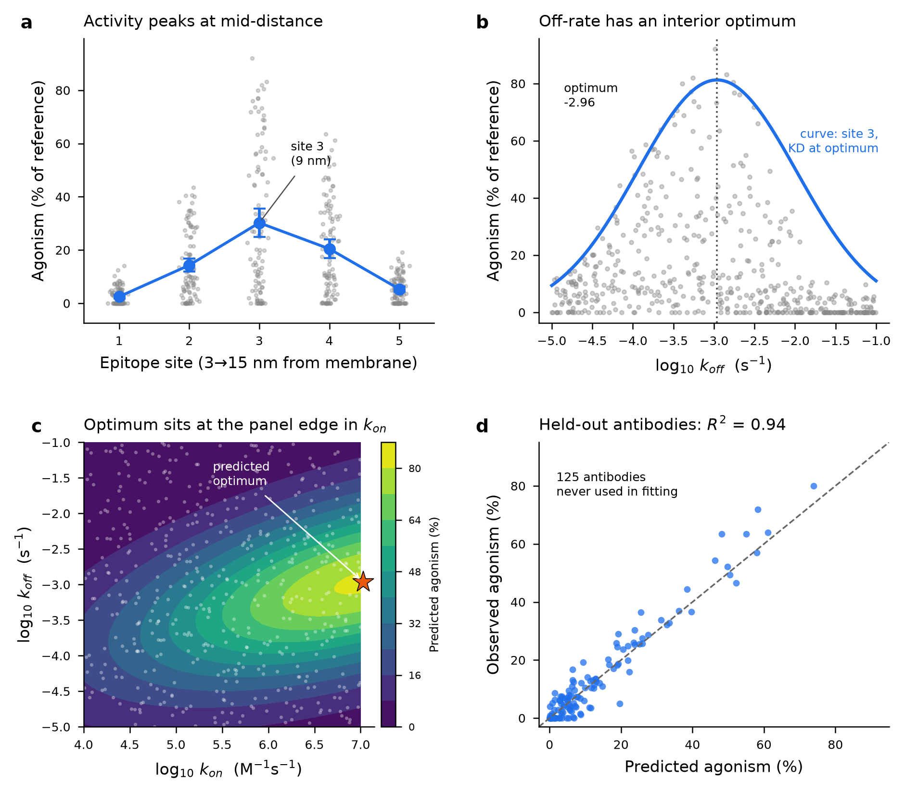

# Project Fulcrum - what switches the receptor on

**Analysis of 500 candidate agonist antibodies.** 375 used for exploration and fitting, **125 held out
and touched once**, at the end.



*(a) Agonism by epitope site, individual antibodies in grey, site mean +/-95% CI in blue. (b) Agonism against
off-rate, all 500 antibodies; curve is the fitted model at site 3 with affinity held at its optimum.
(c) Fitted response surface over the kinetic space the team actually engineers, site 3, plate effect averaged
out; grey points are the panel's measured kinetics; star is the predicted optimum. (d) Held-out predictions
against observation for the 125 antibodies never used in fitting; dashed line is y = x.*

## Headline

Agonism is governed by **three things with interior optima, none of them linear**: epitope distance,
affinity, and off-rate. A plain linear fit misses all three and concludes that distance does not matter.

| Model | Held-out R2 | RMSE (% of reference) |
|---|---|---|
| Plain linear fit: `dist + kon + koff` | **0.11** | 16.2 |
| Recommended log-link model | **0.94** | 4.1-4.4 |

## Why the plain linear fit disappoints

Fitting `agonism ~ epitope_dist_nm + log10_kon + log10_koff` by OLS gives distance a coefficient of
**+0.39 %/nm (p = 0.069)** - effectively "distance has no effect". That is wrong, and it is wrong for a
specific reason: **activity peaks at site 3 and falls away on both sides** (panel a), so a straight line
through a symmetric hump has slope near zero. The same happens in off-rate. Three separate problems have
to be fixed before the data make sense:

1. **Non-monotone site effect.** Site means run 2.5 -> 14.3 -> 30.2 -> 20.5 -> 5.3 %. Site must enter as a
   factor, not as a linear distance. (`site` and `epitope_dist_nm` are redundant - same information.)
2. **Wrong scale.** Within each site the kinetic response has the same *shape* but a different *amplitude*:
   site 3 swings 1.6 -> 56 %, site 1 only 1.4 -> 3.7 %. Site acts as a **multiplicative gain**. On the raw
   scale this forces a thicket of site x kinetics interactions (R2 0.60 -> 0.79); a log link absorbs it
   almost entirely. Measured in censoring-free strata, the noise scales as sd ~ mean^0.57
   (95% CI 0.24-0.89) - variance proportional to the mean, Poisson-like, so a **quasi-Poisson GLM with a
   log link** fits both the multiplicative mean and the variance.
3. **113 of 500 values sit exactly on the 0 floor** (22.6%). A log *transform* would require dropping them,
   and dropping zeros means conditioning on the outcome - it flattens slopes hardest in exactly the
   low-activity sites. A log *link* models E[y] and keeps every row. This matters: the apparent
   site x kinetics interaction is strong on log-transformed positives (p ~ 9e-11) and much weaker once the
   zeros are retained.

## The collinearity question

`log10_KD` is exactly `log10_koff - log10_kon` (verified to 3.6e-15), so all three cannot enter together.
But the resolution is more interesting than "drop one". Added one at a time to the additive model, three
terms came up significant: `kon^2` (p = 6e-4), `koff^2`, and the `kon:koff` cross-term (p = 1.2e-7) - which
is exactly what a **quadratic in KD** expands to, since KD = koff - kon. Re-parameterising to
`KD + KD^2 + koff + koff^2` reproduces the full quadratic surface in (kon, koff) with one fewer parameter
and no loss of fit (F(1,365) = 0.021, p = 0.88). Decomposed, the surface is **-0.237*KD^2 - 0.536*koff^2**:
concave in both, i.e. an optimal **affinity** and, separately, an optimal **residence time**. No cubic
terms and no KD:koff term are needed (all p > 0.29).

## Recommended model

Quasi-Poisson GLM, log link, fitted on the 375 training antibodies:

```
agonism_pct ~ site + log10_KD + log10_KD^2 + log10_koff + log10_koff^2 + plate
```

Dispersion 11.6, pseudo-R2 0.887. Coefficients are on the log scale, so each is a **multiplier** on activity.

| Kinetic term | Coefficient | SE | 95% CI | p |
|---|---|---|---|---|
| `log10 KD` | -4.633 | 0.742 | -6.087, -3.178 | 4.3e-10 |
| `(log10 KD)^2` | -0.232 | 0.041 | -0.312, -0.152 | 1.5e-08 |
| `log10 koff` | -3.074 | 0.485 | -4.026, -2.123 | 2.4e-10 |
| `(log10 koff)^2` | -0.519 | 0.073 | -0.663, -0.375 | 1.4e-12 |

| Site (gain) | Coefficient | Multiplier | 95% CI |
|---|---|---|---|
| site 2 vs site 1 | +1.796 | x6.03 | x3.47-x10.47 |
| site 3 vs site 1 | +2.473 | x11.85 | x6.90-x20.37 |
| site 4 vs site 1 | +2.138 | x8.48 | x4.92-x14.61 |
| site 5 vs site 1 | +0.782 | x2.19 | x1.18-x4.06 |

| Plate (nuisance) | Coefficient | Multiplier | 95% CI |
|---|---|---|---|
| plate 2 vs plate 1 | +0.394 | x1.48 | x1.02-x2.16 |
| plate 3 vs plate 1 | +0.499 | x1.65 | x1.12-x2.43 |
| plate 4 vs plate 1 | +0.278 | x1.32 | x0.90-x1.95 |
| plate 5 vs plate 1 | +0.458 | x1.58 | x1.08-x2.31 |
| plate 6 vs plate 1 | -0.014 | x0.99 | x0.64-x1.51 |

**Fitted optimum** (joint maximum of the kinetic surface; Hessian negative definite, so a true maximum;
95% CIs from 600 bootstrap refits):

| Quantity | Optimum | 95% CI | In panel range? |
|---|---|---|---|
| log10 KD | **-9.99** (KD ~ 100 pM) | -10.16 ... -9.84 | yes (-11.8 ... -5.1) |
| log10 koff | **-2.96** (~15 min residence) | -3.03 ... -2.89 | yes (-5.0 ... -1.0) |
| log10 kon | **7.03** | 6.84 ... 7.23 | **no - at the boundary** (max 7.00) |

## Answers to the six questions

1. **Across sites:** strongly **non-monotone**, peaking at site 3 (9 nm). Relative to site 1 the gain is
   x6.0 (site 2), **x11.9 (site 3)**, x8.5 (site 4), x2.2 (site 5). Site 1 (3 nm, membrane-proximal) is
   nearly dead - 44% of its antibodies read exactly zero.
2. **With kon and koff:** kon is monotone increasing and roughly linear in log space; **koff is not** - it
   has a clear interior optimum at 10^-2.96 s^-1. A straight line in either raw or log koff is not
   reasonable. The honest description is a quadratic surface over (log kon, log koff).
3. **Interactions:** mostly an artifact of mis-specification. site x koff looks significant (p = 1.6e-4)
   until the kon curvature is included, then drops to p = 0.099. A **site x KD** interaction does survive
   (p = 2e-5) and is not explained by the 0 floor - I tested this with 300 parametric-bootstrap replicates
   under a no-interaction model with the floor applied, which reproduced the zero fraction (0.221 vs 0.243
   observed) but produced spurious F of at most 3.55 against 4.63 observed. However, the fitted **optimal
   affinity is the same at every site where it is measurable** (vertex -9.98, -10.00, -9.71, -10.74 for
   sites 2-5); the interaction is in curvature *amplitude*, concentrated in site 1, whose shape is
   unidentifiable because it sits on the floor. **It does not improve held-out prediction and I left it
   out.**
4. **Plate matters, modestly.** Plates span a x1.67 range worst-to-best (plate 3 x1.65 vs plate 6 x0.99
   relative to plate 1; p = 0.0097). Because antibodies were spread evenly across plates - the site x plate
   design is balanced - **plate does not confound the site or kinetic conclusions**; it only inflates
   residual noise. Keeping it in sharpens the coefficients and improves ranking (Spearman rho 0.884 ->
   0.918) but barely changes RMSE.
5. **Best predictive model:** the one above. Held-out R2 = **0.94**, RMSE 4.1-4.4 % of reference on the 125
   untouched antibodies, matching the 5-fold CV estimate within the training set (R2 0.94) - no
   overfitting. Adding the interaction terms *lowers* held-out performance.
6. **Recommendations:** below.

## What I would tell the team

**Take forward:** the top of the ranked list is **site-3 antibodies with KD near 100 pM and koff near
10^-3 s^-1**. The top 15 by predicted activity are all site 3, with observed agonism of 64-92 % (median
74 %). Of the top 50, 32 are site 3, 16 site 4, 2 site 2 - and **none from sites 1 or 5**. Full ranking
attached.

**Design rules for the next round:**
- **Target the 9 nm epitope.** This is the largest single lever - x11.9 over the membrane-proximal site.
  Site 4 (12 nm) is a reasonable hedge at x8.5. Do not spend further effort on sites 1 or 5.
- **Tune to intermediate affinity, not maximum affinity.** The tightest binders in the panel are *worse*
  than 100 pM binders. Affinity maturation past ~100 pM is predicted to lose activity.
- **Tune off-rate to ~10^-3 s^-1** (~15 min residence). Both faster and slower are worse, independently of
  affinity - consistent with needing the receptor held together long enough to signal but not permanently.
- **Raise kon as far as you can.** Within this panel higher is always better, with no interior optimum
  reached.
- **Calibrate the plates.** A x1.67 uncontrolled swing is a large fraction of the differences being used to
  rank candidates. Put a reference agonist on every plate next round.

## Where this model cannot speak

- **The kon optimum is extrapolation.** The fitted optimum, log10 kon = 7.03, lies just past the panel's
  maximum of 7.00. "Push kon higher" is the model reading off its own boundary; whether kon has its own
  optimum beyond 10^7 M^-1 s^-1 **cannot be answered with these data**.
- **One dose, one replicate.** Every antibody was tested once at a single fixed dose, so nothing here
  separates potency from efficacy - a candidate that looks weak may simply have a right-shifted dose
  response. There is no within-antibody replication, so the dispersion (11.6) mixes assay noise and
  biological variation and cannot be decomposed.
- **`receptor_density` does nothing here** (p = 0.21-0.31 in every model). It is a property of the assay
  cells, not a design variable, and its range (0.49-1.97) is narrow - this is not evidence that receptor
  expression is irrelevant in vivo.
- **22.6% of the panel is at the 0 floor**, where the data carry no information about *how* inactive an
  antibody is. Site 1's shape in particular is unidentifiable. A censored-regression (Tobit-style)
  treatment would be the next refinement.
- **Correlation, not mechanism.** The optima are consistent with a receptor-crosslinking story, but this is
  an observational screen: the kinetics were measured, not assigned. The only way to test the design rules
  is to build antibodies at the predicted optimum and see whether they land near 80 %.
- **Site 3 is best within 3-15 nm.** The true geometric optimum may lie between the sampled distances;
  5 discrete sites cannot resolve it. A site at 10-11 nm is untested and might be better.

**Attached:** [fulcrum_ranked_candidates.csv](fulcrum_ranked_candidates.csv) - all 500 antibodies ranked by
predicted agonism with the plate effect averaged out, flagged for held-out membership.
